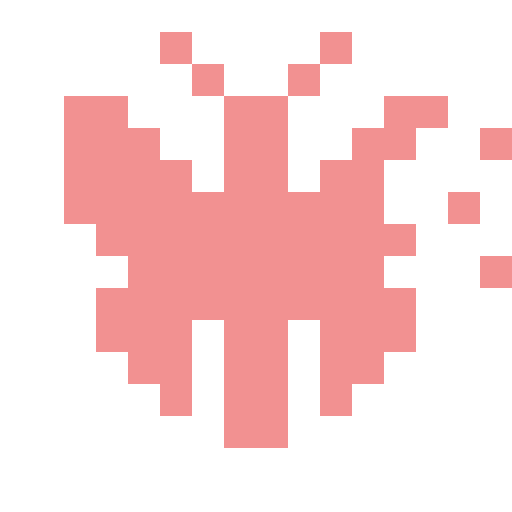

<p align="center">
  
</p>

# Rosa Retícula

A browser-based image workbench for Rosa Retícula: Bayer-inspired ordered dithering, selective screening, and duotone mapping. Adjust treatment parameters, save profiles, export PNG or lossless WebP images, and save reusable JSON recipes. The Video tab adds a localized, pulsating light that changes the tonal base before dithering, with GIF and MP4 export. All processing runs locally in your browser.

Lossless WebP export uses a locally bundled WebAssembly encoder in a dedicated Worker, loaded only when exporting WebP. It preserves the processed raster pixel for pixel without uploading images.

## Pulsation

Switch to **Video** to use the default **Organic field**: seeded, warped noise layers form irregular patches that drift, deform, and pulse independently throughout the canvas. Adjust speed, patch scale, complexity, intensity, local pulsation, frequency, curve, and minimum light. Speed controls drift; frequency controls the local light rhythm. Set speed and local pulsation to zero to freeze the field. Seed reproduces the same field; New field chooses another seed. The field uses periodic trajectories over the complete export duration, so preview, GIF, and MP4 share the same seamless loop. The light field is interpolated from a bounded grid; dithering still runs at the full image resolution.

Choose **Point light** for the original circular source, with radius and softness controls. Drag the light and radius handles on the canvas (or use the arrow keys); exact position and light/dark polarity are in Light settings. Shared image controls continue to apply. Use Play, Pause, Restart, or the timeline to preview.

Export 1–6 complete cycles at 12, 24, or 30 FPS. Duration follows frequency so the animation loops without duplicating its final frame. GIF uses a dependency-free GIF89a/LZW encoder and the workbench's exact 256-color duotone palette; frame delays distribute GIF's 10 ms rounding across the loop. MP4 uses Mediabunny and the browser's H.264 encoder, which must be available for the selected size. Its fixed Preserve details setting requests quantizer 10, falling back to an explicit variable bitrate of 0.75 bits per pixel per frame (4–160 Mbps) when quantizer control is unsupported. Both paths use quality latency and a detail content hint. The effective frame rate is passed to both capability checks and the encoder to preserve the exact loop duration. These are conservative starting settings, pending comparison with user exports; MP4 remains lossy and the browser may still use 4:2:0 chroma subsampling. Odd dimensions are padded on the right/bottom for H.264 without resampling the dither pattern. Both exporters run in a dedicated Worker with progress and cancellation. Exports are limited to 500 million processed pixels across all frames; GIF files also have a 128 MiB limit.

JSON recipes and saved profiles retain their existing image-only format. Animation settings remain in the current session.

## Development

Requires Node.js 24.12+ and Yarn 1.22.22.

```sh
yarn install --frozen-lockfile
yarn dev
```

The development server runs at `http://localhost:5178/`.

```sh
yarn test     # Run tests and validate translations
yarn build    # Type-check and build into dist/
yarn preview  # Preview the production build
```

The app uses TypeScript, Vite, Canvas, and a Web Worker. English and Brazilian Portuguese catalogs live in `src/i18n/locales/`. After editing translations, run `yarn locales:format` and `yarn locales:check`.

Edit the workbench markup in `src/ui/workbench.html`. Its reusable control and help templates are cloned by `src/ui/workbench.ts`, which fills dynamic values and applies translations before the controller initializes interactive components. DOM tests check translation keys, controller IDs, and accessibility references without opening a browser.

## License

The original algorithm (Rosa Retícula) and original project code are licensed under [GPL-3.0](LICENSE.txt). Third-party dependencies remain under their respective licenses.

## Credits

Created by [rosa-gus](https://rosa-gus.github.io/portfolio). The blur implementation follows [Pillow's extended-box approach](https://github.com/python-pillow/Pillow/blob/12.3.0/src/libImaging/BoxBlur.c). Font licenses are included in [public/licenses/](public/licenses/).

Example photographs are credited in the [manifest](src/assets/examples/manifest.json). The photograph used in `public/og-image.png` is by [Yang Deng](https://unsplash.com/@palon).
