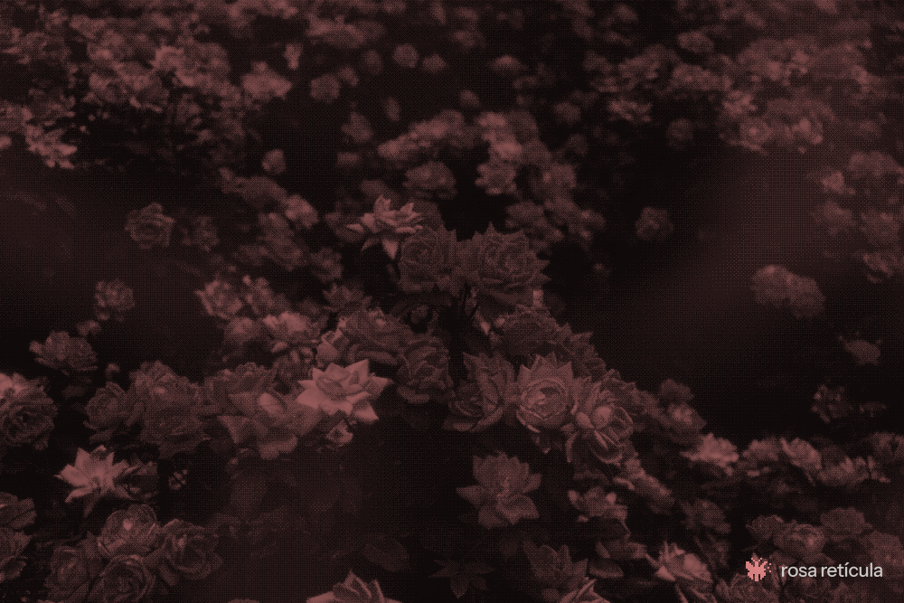

# Rosa Retícula

A browser-based image and animation workbench for Rosa Retícula: Bayer-inspired ordered dithering, selective screening, and duotone mapping. Adjust treatment parameters, save profiles and JSON recipes, and export PNG, lossless WebP, GIF, or MP4. All processing runs locally in your browser.

Lossless WebP export uses a locally bundled WebAssembly encoder in a dedicated Worker, loaded only when exporting WebP. It preserves the processed raster pixel for pixel without uploading images.

## Animation

Switch to **Animation** and choose **Organic field** for drifting, locally pulsing light, or **Point light** for a circular source you can position on the image. Adjust the frequency, intensity, and curve, then play or scrub the preview.

Export 1–6 complete cycles as a looping GIF or MP4 at 12, 24, or 30 FPS. MP4 requires browser support for H.264 encoding. Animation settings apply to the current session. Saved profiles and JSON recipes store image settings.

## Development

Requires Node.js 24.12+ and Yarn 1.22.22.

```sh
yarn install --frozen-lockfile
yarn dev
```

The development server runs at `http://localhost:5178/`.

```sh
yarn test     # Run tests and validate translations
yarn build    # Type-check and build into dist/
yarn preview  # Preview the production build
```

The app uses TypeScript, Vite, Canvas, and a Web Worker. English and Brazilian Portuguese catalogs live in `src/i18n/locales/`. After editing translations, run `yarn locales:format` and `yarn locales:check`.

Edit the workbench markup in `src/ui/workbench.html`. Its reusable control and help templates are cloned by `src/ui/workbench.ts`, which fills dynamic values and applies translations before the controller initializes interactive components. DOM tests check translation keys, controller IDs, and accessibility references without opening a browser.

## License

The original algorithm (Rosa Retícula) and original project code are licensed under [GPL-3.0](LICENSE.txt). Third-party dependencies remain under their respective licenses.

## Credits

Created by [rosa-gus](https://rosa-gus.github.io/portfolio). The blur implementation follows [Pillow's extended-box approach](https://github.com/python-pillow/Pillow/blob/12.3.0/src/libImaging/BoxBlur.c). Font licenses are included in [public/licenses/](public/licenses/).

Example photographs are credited in the [manifest](src/assets/examples/manifest.json). The original photograph in the animated banner is by [@herasun](https://unsplash.com/@herasun). The photograph used in `public/og-image.png` is by [Yang Deng](https://unsplash.com/@palon).
